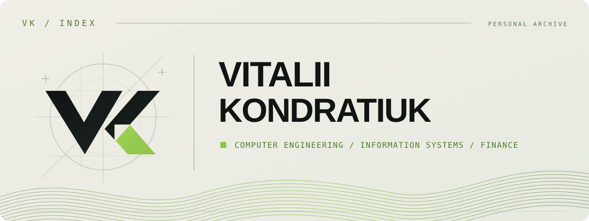
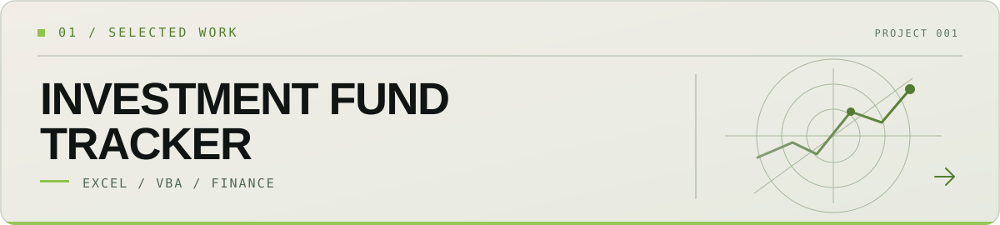
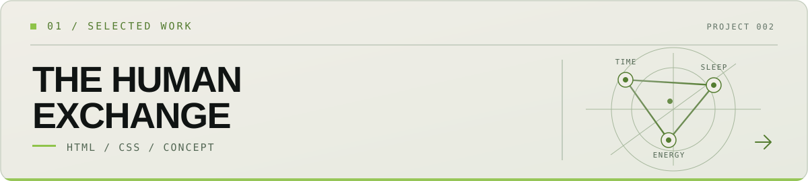
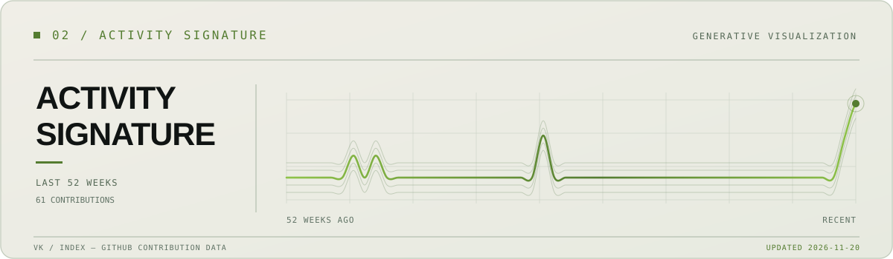

<!--
  VK / INDEX
  Personal GitHub Profile
  github.com/VKondr0

  Responsive identity system:
  - Desktop / Mobile
  - Dark / Light
-->

  <!-- ====================================== -->
  <!-- IDENTITY                               -->
  <!-- ====================================== -->

  <picture>

    <source
      media="(max-width: 768px) and (prefers-color-scheme: dark)"
      srcset="./assets/identity/hero-mobile-dark.svg"
    />

    <source
      media="(max-width: 768px) and (prefers-color-scheme: light)"
      srcset="./assets/identity/hero-mobile-light.svg"
    />

    <source
      media="(prefers-color-scheme: dark)"
      srcset="./assets/identity/hero-dark.svg"
    />

    <source
      media="(prefers-color-scheme: light)"
      srcset="./assets/identity/hero-light.svg"
    />

    

  </picture>

   
   

  <!-- ====================================== -->
  <!-- SELECTED WORK / PROJECT 001            -->
  <!-- ====================================== -->

  <a href="https://github.com/VKondr0/gonzaga-student-investment-fund-tracker">

    <picture>

      <source
        media="(max-width: 768px) and (prefers-color-scheme: dark)"
        srcset="./assets/projects/project-1-mobile-dark.svg"
      />

      <source
        media="(max-width: 768px) and (prefers-color-scheme: light)"
        srcset="./assets/projects/project-1-mobile-light.svg"
      />

      <source
        media="(prefers-color-scheme: dark)"
        srcset="./assets/projects/project-1-dark.svg"
      />

      <source
        media="(prefers-color-scheme: light)"
        srcset="./assets/projects/project-1-light.svg"
      />

      

    </picture>

  </a>

   
   

  <!-- ====================================== -->
  <!-- SELECTED WORK / PROJECT 002            -->
  <!-- ====================================== -->

  <a href="https://github.com/VKondr0/bmis235-html-1">

    <picture>

      <source
        media="(max-width: 768px) and (prefers-color-scheme: dark)"
        srcset="./assets/projects/project-2-mobile-dark.svg"
      />

      <source
        media="(max-width: 768px) and (prefers-color-scheme: light)"
        srcset="./assets/projects/project-2-mobile-light.svg"
      />

      <source
        media="(prefers-color-scheme: dark)"
        srcset="./assets/projects/project-2-dark.svg"
      />

      <source
        media="(prefers-color-scheme: light)"
        srcset="./assets/projects/project-2-light.svg"
      />

      

    </picture>

  </a>

   
   

  <!-- ====================================== -->
  <!-- ACTIVITY SIGNATURE                     -->
  <!-- ====================================== -->

  <picture>

    <source
      media="(max-width: 768px) and (prefers-color-scheme: dark)"
      srcset="./assets/activity/signature-mobile-dark.svg"
    />

    <source
      media="(max-width: 768px) and (prefers-color-scheme: light)"
      srcset="./assets/activity/signature-mobile-light.svg"
    />

    <source
      media="(prefers-color-scheme: dark)"
      srcset="./assets/activity/signature-dark.svg"
    />

    <source
      media="(prefers-color-scheme: light)"
      srcset="./assets/activity/signature-light.svg"
    />

    

  </picture>

